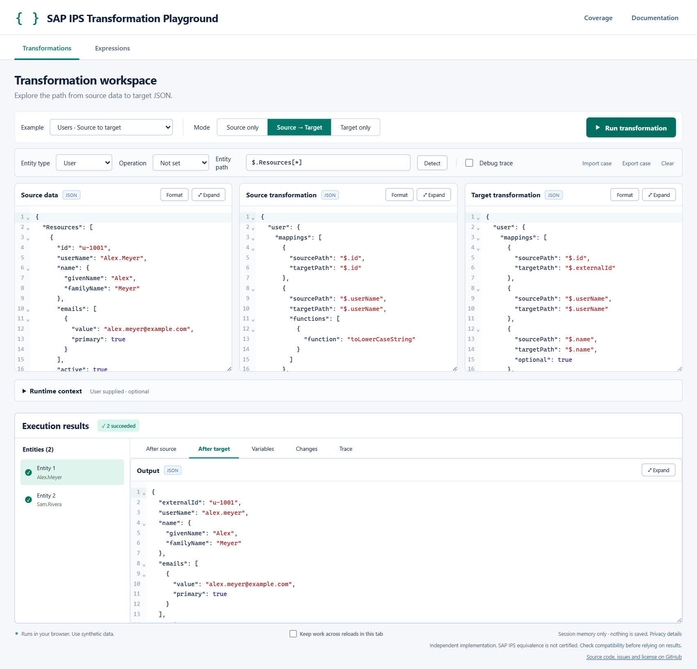

# SAP IPS Transformation Playground

**Live site: https://ipsplayground.rodriguessa.com/**

Try SAP Identity Provisioning (IPS) transformations in your browser. Paste a JSON entity, paste a source and/or target transformation, press **Run**, and see the output of every stage, what changed, and which mapping failed and why.



> **Independent project.** This is not an SAP product and not a certified IPS runtime. SAP and SAP Identity Provisioning are trademarks of SAP SE; this project is not affiliated with or endorsed by SAP. Results are a close local approximation, **not proof of what your IPS tenant will do**. Always confirm against IPS before relying on a result. See [Compatibility](#compatibility).

## What it does

- **Three run modes:** *Source only*, *Target only* or *Source → Target*, so you can test a read transformation, a write transformation, or the whole chain on one entity or a batch.
- **Per-stage results:** *After source*, *After target*, *Variables* (values set with `targetVariable`), *Changes* (a diff between stages) and an optional per-mapping *Trace*.
- **Clear failures:** a failed entity shows the stage, the mapping number and the exact reason. Unsupported syntax is reported as an error and never guessed.
- **Editors that know the language:** JSON editors with diagnostics, hover help and completions for mapping keys, functions and paths. Accept a suggestion with Tab or Enter. Editors can be resized and expanded to a larger window.
- **Expression workspace:** evaluate a JSONPath or an IPS condition against your data.
- **Runtime context:** supply the things IPS normally provides (variables, properties, the operation, resolved IDs). The toolbar has an **Operation** selector for mappings that use a `scope`. When a run needs a variable you haven't given, the app adds a placeholder to the context for you to fill in.
- **Cases:** export your whole workspace to a JSON file and import it again later. An imported case never runs by itself.

## Privacy

Everything you enter is processed in your browser. There is no server for your data and no cookies. Nothing is stored unless you tick *Keep work across reloads in this tab*, which keeps the inputs (never the results) in that tab's `sessionStorage`. **Use fictitious data.** Details are in the app under *Privacy details*.

**Visitor statistics.** The live site counts anonymous page views with [Umami](https://umami.is) (cookie-free). Each page load sends the page address, title, referrer, screen size and browser language to Umami, and nothing is sent when the browser has Do Not Track on. Editor contents, transformations and results are never part of that request. A Content-Security-Policy (`vercel.json`) limits the site to its own origin plus `cloud.umami.is` and `gateway.umami.is`. The tracking script is in `index.html`; remove it to run without any analytics.

## Run it locally

Requires Node.js 20.19+ or 22.12+ and npm.

```bash
git clone https://github.com/19jmrs/sap-ips-playground.git
cd sap-ips-playground
npm ci
npm run dev
```

Open the address Vite prints (normally http://127.0.0.1:5173). No credentials, API keys or environment variables are needed.

| Command | What it does |
| --- | --- |
| `npm run dev` | Development server |
| `npm test` | Runs the test suite (Node's built-in runner) |
| `npm run build` | Builds the static site into `dist/` |
| `npm run preview` | Serves `dist/` locally |
| `npx prettier --check "src/**/*.{js,jsx,css}" "tests/*.js"` | Checks formatting |

## Deploy to Vercel

The app is a static Vite site, so no server code or environment variables are involved.

1. Push the repository to GitHub (already done if you forked it).
2. In Vercel choose **Add New → Project** and import the repository.
3. Keep the detected settings: framework **Vite**, build command `npm run build`, output directory `dist`.
4. Deploy.

After each new deployment, a browser tab that was already open still points at the previous build's files and can show *"The execution worker failed"*. Reloading the page fixes it.

## Using it

1. Pick an example from the list, or paste your own entity into **Source data**.
2. Choose a mode, then paste your **source** and/or **target** transformation.
3. Set the **entity path** (use *Detect* for a guess) and the **entity type**.
4. If a mapping has a `scope`, choose an **Operation** (`createEntity`, `patchEntity` or `deleteEntity`).
5. Press **Run transformation**. Editing never runs anything by itself.

### Runtime context

The collapsible *Runtime context* box is JSON that stands in for what IPS provides at run time:

```json
{
  "operation": "createEntity",
  "variables": { "entityIdTargetSystem": "target-42" },
  "properties": { "domain": "example.com" },
  "resolutions": { "user": { "source-1": "target-42" } },
  "localeMappings": [["EN", "en-US"]]
}
```

- **Variables are local to a stage.** A variable set by a source mapping is not visible to the target stage, with one exception: in a Source → Target run, `entityIdSourceSystem` set by the source stage (`{"sourcePath": "$.id", "targetVariable": "entityIdSourceSystem"}`) can be read by the target stage of the same entity. This follows SAP's description of that variable but has **not** been checked against a real IPS run.
- **`entityIdTargetSystem`** and other values IPS would supply must be given under `variables`.
- **Missing values are errors, never invented.** A run is refused while a placeholder the app inserted (`REPLACE_WITH_VALUE`) is still in the context.
- A mapping with a `scope` needs an operation, and runs only when the operation is one of its scopes. A mapping without a `scope` runs when no operation is set or it is `createEntity`, and is skipped for `patchEntity` and `deleteEntity`.

More examples and guidance for building a reference case are in [docs/context.md](docs/context.md).

## Compatibility

The evaluator is an independent JavaScript implementation based on SAP's public documentation. It covers the mapping types `set`, `remove`, `rename` and `valueMapping`, all 27 documented mapping functions, IPS conditions and a Jayway-style JSONPath dialect.

- Conditions, JSONPath, regular expressions and dates were compared against real **Jayway JsonPath 2.9.0** and the JDK in a [differential review](docs/engine-review.md). That is evidence about those libraries, **not about SAP's service**.
- No row of the compatibility matrix has been verified against a live IPS tenant yet. See [docs/coverage.md](docs/coverage.md) for what is supported, what is bounded and what is explicitly unsupported.
- The documented IPS features the project is based on are listed in [docs/ips-inventory.md](docs/ips-inventory.md).

If a transformation behaves differently in IPS than here, please [open an issue](https://github.com/19jmrs/sap-ips-playground/issues) with an anonymised example.

## Known limits

- A run is limited to 5 MB of input and stops after 5 seconds.
- Very large documents can make the editors slow.
- Runs are manual only; there is no live evaluation while typing.
- No remote operations are simulated: `operation` only selects which scoped mappings run, and nothing is created, patched or deleted anywhere.
- Editor intelligence comes from CodeMirror. There is no Language Server Protocol server (see [docs/architecture.md](docs/architecture.md)).
- Tested in Chromium. Other browsers should work but have not been checked.

## Project layout

```
src/engine/       the transformation evaluator (paths, conditions, mappings, functions)
src/editor/       editor diagnostics, hover text and completions built on the engine's validators
src/state/        workspace state, run requests, case files, session storage
src/components/   React UI
src/hooks/        workspace hook, modal and session helpers
src/execution*.js runs each request in a disposable Web Worker with a size limit and a timeout
tests/            test suite
docs/             coverage matrix, IPS inventory, runtime context guide, architecture
```

## Contributing

Issues and pull requests are welcome. Before sending a change, run `npm test` and the Prettier check above. Please use only fictitious or anonymised data in examples, tests and issues, and add a test for any behaviour you change.

## License

[MIT](LICENSE) © 2026 Jorge
